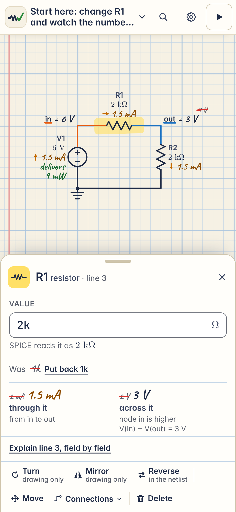

# PlainSpice

**Real SPICE, explained in plain words.** A beginner-first, accessible circuit simulator that
runs in your browser, made for first- and second-year students and for the
[Solved Circuits](https://www.youtube.com/@SolvedCircuits) channel, where every answer is checked
in a circuit simulator.

**Try it: <https://plainspice.com/>** · [Engine check](https://plainspice.com/spike/) ·
[Licences and source](https://plainspice.com/licenses/)


## What it does

PlainSpice is not a new simulator: the engine is **ngspice 47**, the same engine KiCad uses,
compiled to WebAssembly and run in a background worker in your browser. It gives the same
numbers as ngspice on a PC (checked to 6 significant figures; today they are bit-identical).
Everything around it is for beginners:

- **It draws the circuit and writes the answers on it.** The netlist is drawn on the notebook page
  of the Solved Circuits videos, and ngspice's results are handwritten on the drawing: each node's
  voltage, each part's current with an arrow the way it flows, each source's power. Click a part
  (tap it on a phone), type a new value, and ngspice runs the circuit again as you type: the new
  numbers appear, the old ones crossed out. A value SPICE would misread ("4,7k", "1 k") is caught on
  the card, with why and a fix, before it reaches the netlist. The first screen invites you to try it.
- **Build the circuit on the drawing.** Choose a part in the margin (or press its letter: R, C, L,
  V, I, E, F, G, H, 0 for ground) and click where it goes: before the click you see where its ends
  land and which nodes they connect to. Wire pins together (W), drag parts (their wires follow), turn (T),
  mirror (M) and reverse (Shift+R) them, rename nodes, delete; every change is written to the netlist,
  ngspice runs it again, and screen readers hear what changed. On a blank page the first part also
  writes `.op` and `.end`, so ngspice runs the circuit as you build it. Without a mouse, Add a part (A)
  takes a kind, a value (checked as the card checks it) and two nodes from lists, and each part's card
  shows its Connections: Connect to makes an end's node and another node one node, with every part
  on them, and Disconnect gives an end a node of its own; on a phone, tap to place, and hold a part
  a moment to drag it with a finger.
- **One netlist, two ways in.** The Netlist panel shows the same circuit as SPICE reads it, on a
  dark "simulator screen"; type there and the drawing follows, change the drawing and the netlist
  follows (the positions go into `*@` comment lines that ngspice skips). One undo covers both.
- **It explains as it simulates.** Each netlist line is shown as a field table in plain words
  (name, + node, − node, value; for a current source: from node, to node, current). Every result is
  also in the Numbers panel's tables, in plain units: `1.200000e+01` becomes **12 V**, and every
  current says which way it flows.
- **It catches beginner traps before you run**, says why, and offers a one-click fix: `1M` is a
  milliohm (mega is `1meg`), `3A` means 3 attoamps, no ground (node 0), a node with only one
  connection, a current source with no path, a duplicate name, an unknown first letter, and more.
  ngspice gives confident numbers for several of these; PlainSpice tells you.
- **It is accessible from day one** (WCAG 2.2 AA): everything works from the keyboard, the
  circuit and its results are described for screen readers, node colours are colour-blind-safe
  and never the only signal, and there are high-contrast, large-text and reduced-motion modes.
- **It is shareable.** The whole circuit lives in the link: no account, no server. Every Solved
  Circuits video can link "Open this circuit", and the circuit opens drawn as in the video. It works
  offline and on a phone (a wide drawing turns to fit the screen, "As in the video" one tap away),
  and exports netlists for ngspice and LTspice.




How it differs from [EEcircuit](https://github.com/eelab-dev/EEcircuit), the closest existing
tool: [docs/eecircuit-comparison.md](docs/eecircuit-comparison.md).

## Status

First milestone, November 2026: the decisions ([docs/decisions/](docs/decisions/)), the engine
(checked against native ngspice: [docs/fixture-results.md](docs/fixture-results.md)), the
netlist-first app, and its tests in CI (unit, golden against native ngspice, and end-to-end with
accessibility checks on a desktop and a phone). The app was then reviewed for SPICE wording,
accessibility, security and speed on phones, and the findings were fixed.

Milestone 2, step A: the app in the Notebook look Tarık chose ([0014](docs/decisions/0014-the-look.md),
[0015](docs/decisions/0015-notebook-canvas.md), [0016](docs/decisions/0016-the-app-shell.md)): the
drawing first, solved live as you edit, with every feature of the first app in panels. Step B: the
schematic editor ([0017](docs/decisions/0017-the-schematic-editor.md)): place, wire, move, turn, mirror,
reverse and delete parts on the drawing, by mouse, finger or keyboard, then reviewed for how it
feels, for keyboards and screen readers, and for keeping the netlist in step, and most findings
fixed (0017 says which were not, and why). Step C: the examples of the four videos drawn as in the videos, recorded from the channel's
own drawing code ([0018](docs/decisions/0018-the-examples-drawn-as-in-the-videos.md); each example
next to its video: [docs/design/video/](docs/design/video/README.md)). What's next and the open
questions: [docs/plan.md](docs/plan.md).

## Develop

Node 22 or newer.

```bash
npm ci
```

```bash
npm run dev
```

```bash
npm test
```

```bash
npm run test:e2e
```

`npm test` runs the unit tests and the golden tests: every fixture in `tests/fixtures/` runs
through the WebAssembly engine and must match native ngspice 47 and 42 to 6 significant figures.
The engine is committed (`engine/dist/`); to rebuild it from the ngspice source, see
[engine/README.md](engine/README.md). More in [CONTRIBUTING.md](CONTRIBUTING.md).

| Path | What |
|---|---|
| `src/spice/` | the netlist model: number reader, parser, trap checks, explanations |
| `src/engine/` | ngspice in a Web Worker; results and messages |
| `src/app/` | the user interface (React 19 + React Aria Components): the netlist store, live runs, the shell, the schematic editor |
| `src/schematic/`, `src/notebook/` | the circuit drawn from its netlist; the Notebook page it is drawn on |
| `src/editor/`, `src/plot/`, `src/share/`, `src/export/` | CodeMirror editor, uPlot plots, share links, export |
| `engine/` | the reproducible ngspice 47 WebAssembly build |
| `docs/` | decisions, research, SPICE facts with evidence, the plan |

## Licence

PlainSpice's code is [MIT](LICENSE); its documentation and the example circuits from the
channel's videos ([examples/](examples/)) are CC BY 4.0. The simulation engine is
ngspice 47 (Modified BSD, with numparam under the GNU LGPL): see
[THIRD_PARTY_NOTICES.md](THIRD_PARTY_NOTICES.md); its exact source is served next to it. The names
"PlainSpice" and "Solved Circuits" are not licensed: [TRADEMARKS.md](TRADEMARKS.md).

PlainSpice uses ngspice; it is not made or endorsed by the ngspice team.
